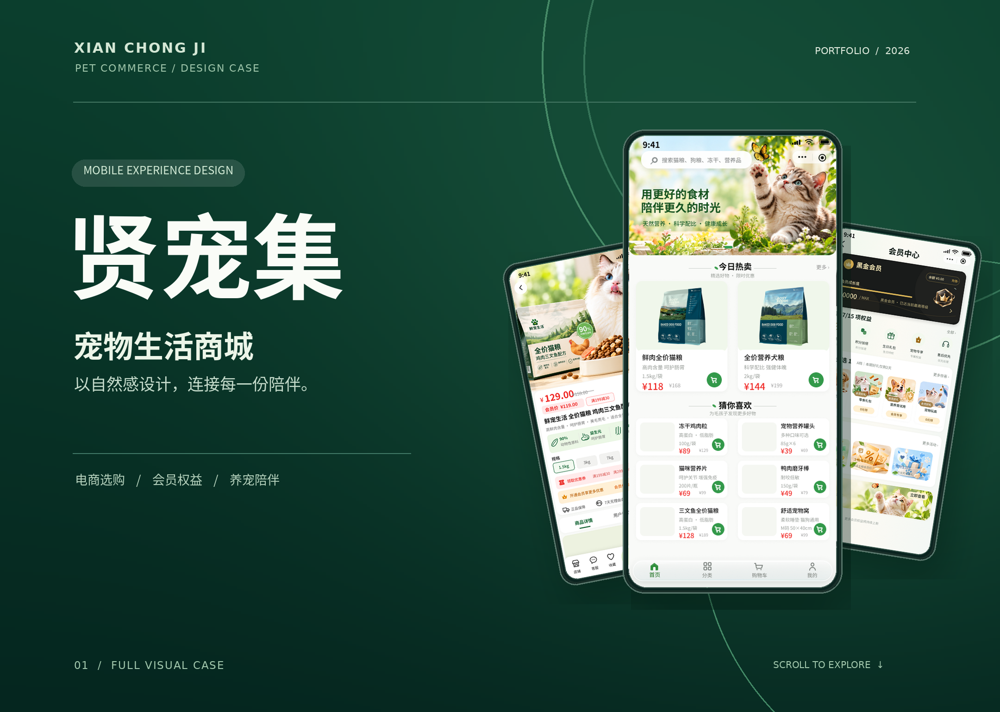

# 贤宠集 · UI/UX 设计作品集

**Xianchongji · Pet E-commerce UI/UX Portfolio**

基于已完成的「贤宠集」宠物商城设计稿整理的个人作品展示，包含 **25 张移动端 UI 界面、5 张会员等级卡片、12 个视觉章节**。

### 📖 查看作品集

- [打开网页作品集](./index.html)（GitHub 仓库内查看源文件；启用 GitHub Pages 后可通过网页访问）
- [完整作品集 PDF](./downloads/xianchongji-portfolio.pdf)
- [高清作品集长图 PNG](./downloads/xianchongji-long-image.png)

### 🎨 内容

| 章节 | 介绍 |
| --- | --- |
| 01–03 | 封面、项目概览、视觉语言 |
| 04–06 | 商品发现、详情与购物车、订单和售后 |
| 07–09 | 会员体系、会员等级、宠物管理与互动 |
| 10–12 | 完整界面总览、品牌长页、结束页 |

### 🌐 发布到 GitHub Pages

这是**静态网站**，不需要 npm、Node.js 或服务器。

1. 创建名为 `xianchongji-ui-portfolio` 的 **Public** 仓库。
2. 将此项目所有文件及文件夹（**不是 ZIP 压缩包本身**）上传到仓库根目录。
3. 进入仓库 `Settings → Pages`。
4. 在 `Build and deployment` 中选择 `Deploy from a branch`，并指定 `main` + `/(root)`，然后保存。
5. 页面部署完成后，访问 `https://<你的 GitHub 用户名>.github.io/xianchongji-ui-portfolio/`。

**文件说明**：`index.html` 网页入口、`styles.css` 样式、`site.js` 轻量交互、`assets/sections/` 12 张完整展示图、`downloads/` 高清 PDF 和长图。

### 🛡️ 素材与版权

本仓库用于展示设计成果。作品中的设计稿及展示图均保留原有内容，未在此网站中重绘页面。除明确获得授权外，请勿直接二次使用其中的视觉素材或设计内容。

### 🖥️ macOS 一键发布脚本（可选）

解压 ZIP 后，在 Mac 上运行根目录的 **`一键发布到GitHub.command`**。脚本使用 GitHub 官方命令行工具 `gh`，可以自动创建公开仓库、上传文件并尝试启用 GitHub Pages。首次使用时需要在浏览器里登录授权；脚本不会索取你的账号密码，也不会把凭据保存到作品集文件中。发布前会再次询问是否将文件公开。

如果 macOS 阻止直接打开，可在终端进入文件夹后运行：`bash 一键发布到GitHub.command`。
